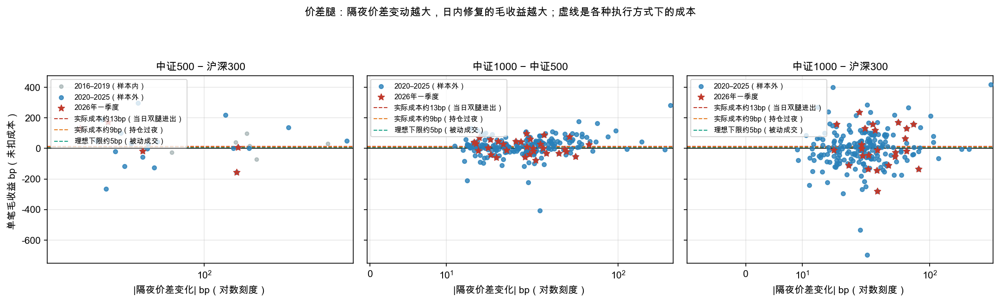
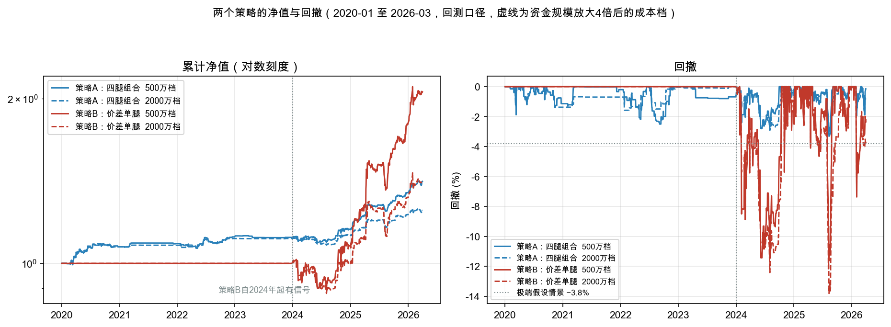
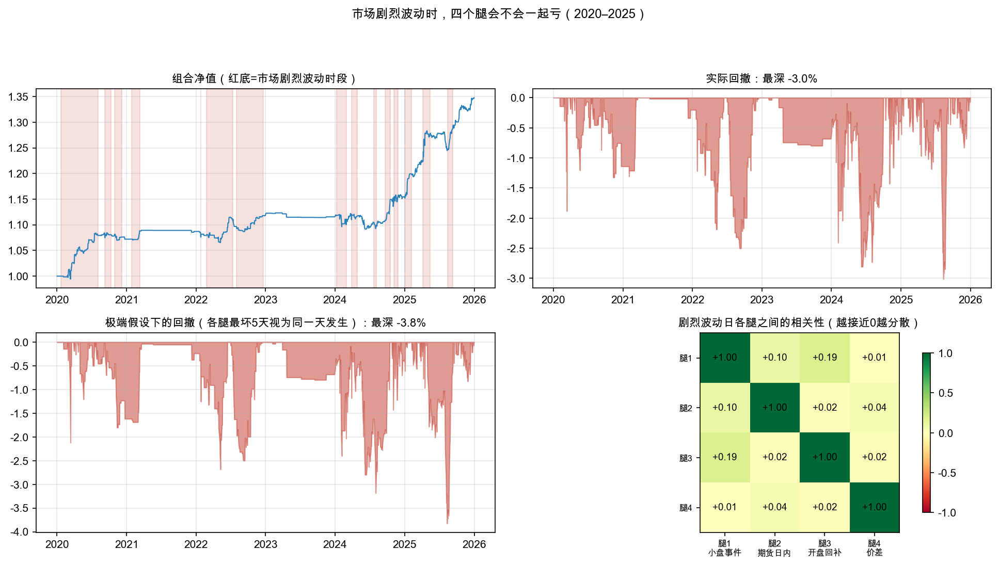
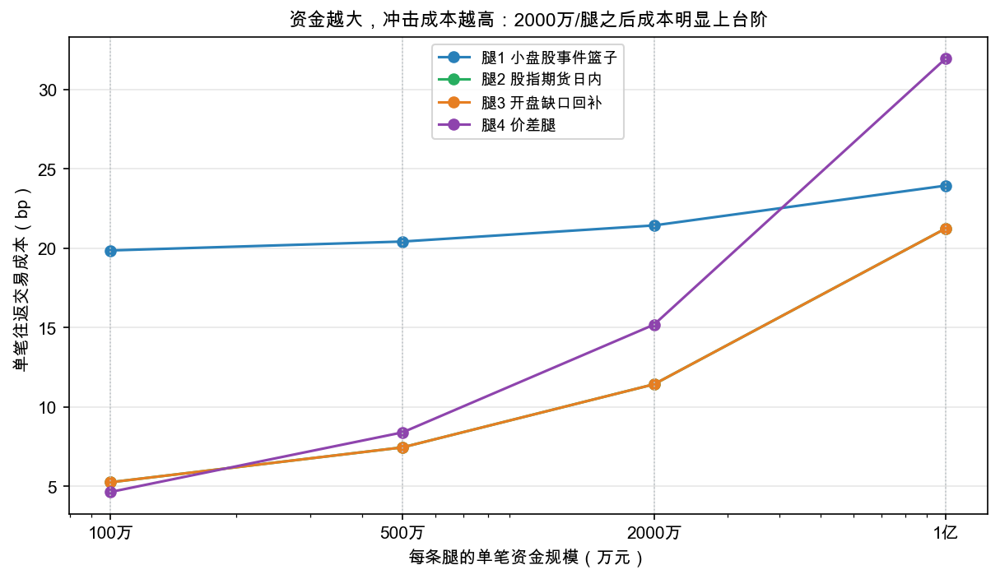
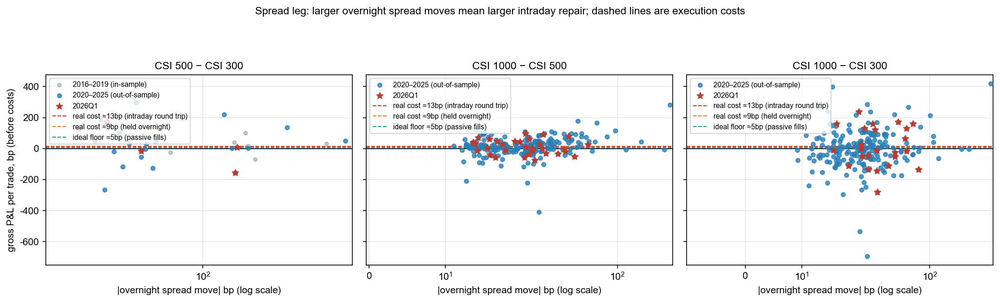
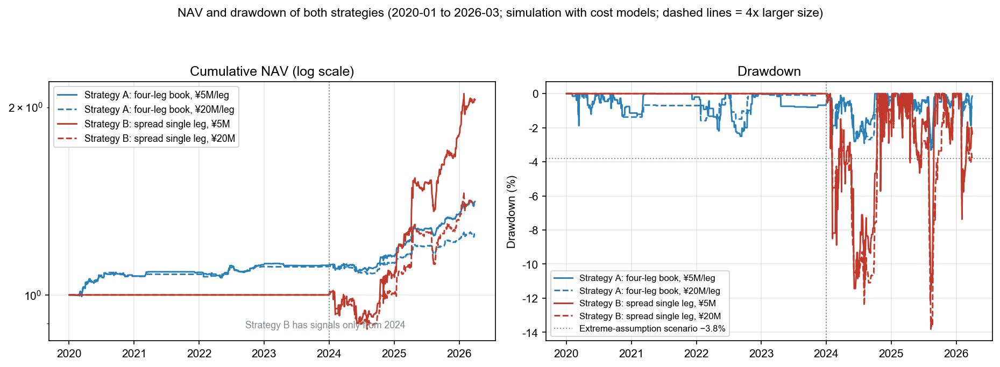
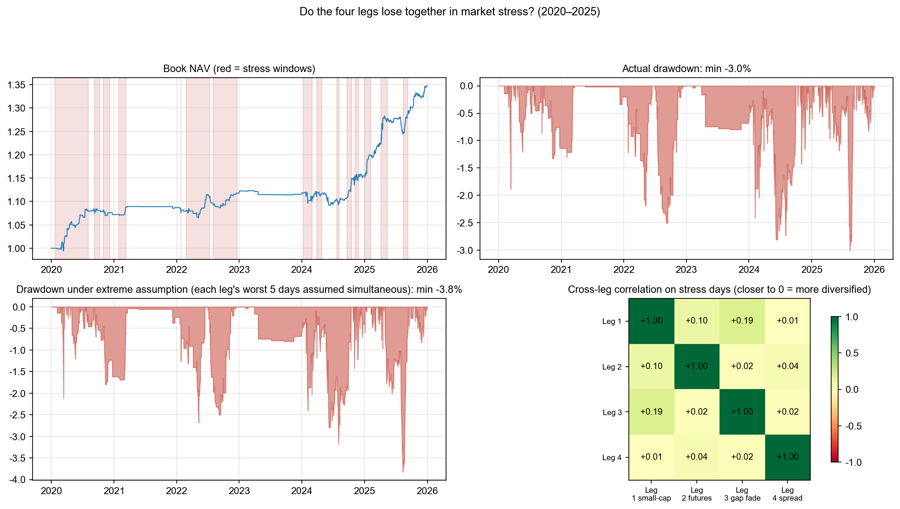
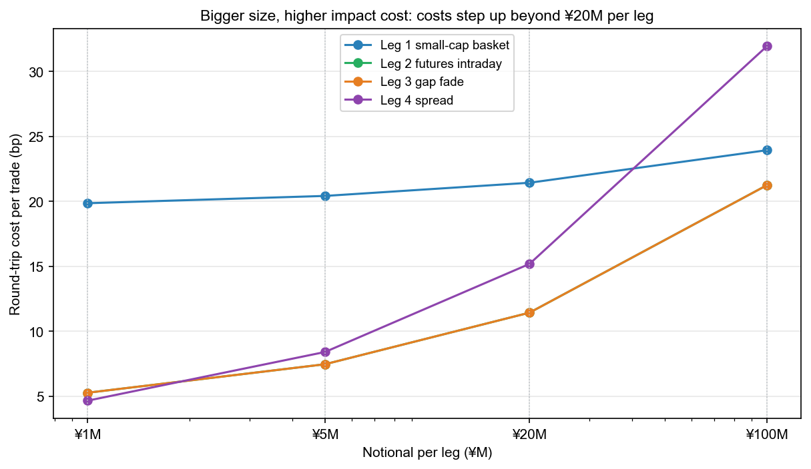

# 美股—A股联动卫星策略：双策略对照

两个同源的量化策略，交易标的都是 A 股指数期货和现货，持仓周期一天以内到一天。
**策略 B 是策略 A 的第四条腿单独拿出来**，所以两者共享同一套研究管线，不是互相独立的两个收益来源。

| | 策略 A：四腿组合 | 策略 B：IM−IC 基差价差单腿 |
|---|---|---|
| 构成 | 四条互相低相关的腿，等权 | 只有一条腿（同策略 A 的第四条） |
| 依赖数据 | 美股 + A股 | 只用 A股 |
| 定位 | 分散、回撤小 | 收益高但集中、回撤深 |
| 适合角色 | 卫星组合 | 危机 alpha 补充 |

---

## 1. 经济学原理

美股隔夜大跌会传导到 A 股：第二天开盘 A 股往往跳空低开，而且经常跌得过头。过头的部分会在当天或随后一天内被修复。这个"过度反应—修复"就是全部收益来源，两条路径：

- **做单边的修复（策略 A 的前三条腿）**：恐慌最重的那些天，在开盘承接——买一篮子小盘股票次日卖出、或买中证500期货持有到收盘、或在大幅跳空开盘后做 15 分钟内的回补。
- **做相对价的修复（第四条腿 / 策略 B）**：恐慌夜里，机构对冲集中在中证1000，导致 1000 期货相对 500 期货贴水异常扩大。这个价差会向正常水平收敛。做多被压得更狠的一边、做空另一边，隔天平仓——指数涨跌本身被对冲掉，只赚价差收敛。

一个重要事实：这个异象在指数点位上非常强，但在期货价格上大部分已经被市场定价掉了，所以做出来的是 1 到 2 量级的夏普，而不是纸面上的 3+。

价差腿的证据图如下：横轴是隔夜价差变动的大小，纵轴是单笔交易的毛收益（未扣成本）。变动越大，日内修复的毛收益越大；虚线是不同执行方式下的真实成本线，毛收益要高于成本线才赚钱。

## 2. 策略规则

回测全部采用"只用过去、预测未来"的滚动方式：每个月用此前所有数据重新估计参数，再用于当月交易，不存在用未来数据调参。样本内 2016-06 至 2019、样本外 2020-01 至 2025-12、最新一段 2026Q1。

**策略 A 的四条腿：**

| 腿 | 什么时候交易 | 怎么做 |
|---|---|---|
| 1. 小股票事件腿 | 美股隔夜跌超 2% 的次日 | 开盘买入一篮子小市值股票，再下一个交易日开盘卖出；卖不出（跌停）就顺延 |
| 2. 期货日内腿 | 美股隔夜大跌，且处于恐慌状态（波动很高或期货贴水很深）的交易日 | 09:30 买入中证500期货，收盘卖出，赚当天修复 |
| 3. 开盘回补腿 | A股波动处于高位、且开盘大幅跳空的交易日 | 09:30 反向入场，09:45 平仓，赚开盘过度反应的回补 |
| 4. 价差腿 | 1000/500 期货贴水差偏离自身正常水平足够大时 | 09:30 多空各一条建立价差仓位，次日收盘平仓；信号越强仓位越大（上限 2 倍） |

每条腿只在"预期收益能覆盖交易成本"时才触发；第四条腿按信号强度连续调仓，其余按满仓/空仓二值。

**交易成本按真实规则计**：交易所手续费（区分当天平仓与隔天平仓的不同费率、2023 年降费分时代）+ 最小报价单位一个 tick 的价差 + 与市场承接量挂钩的冲击成本（下单越大、越贵）。

## 3. 业绩（已扣全部成本，单腿名义 500 万元档）

| 窗口 | 策略 A（四腿组合） | 策略 B（价差单腿） |
|---|---|---|
| 样本内 2016-06 至 2019 | 0.42% / 夏普 0.69 / 最大回撤 −0.32% | —（标的 2022 年中才上市） |
| 样本外 2020-01 至 2025-12 | 5.07% / 1.37 / −3.01% | 10.44% / 1.00 / −11.62%（信号全部在 2024 年之后，此前空仓） |
| 2024-01 至 2026-03（B 可交易全期，337 笔） | 10.75% / 2.14 / −3.01% | 34.12% / 1.91 / −11.62% |
| 2026Q1 | 20.41% / 3.70 / −1.93% | 58.41% / 3.49 / −7.37% |

（年化收益 / 夏普比率 / 最大回撤）

**分年（策略 A，500 万档）**：2020 +7.2%、2021 +1.4%、2022 +2.8%、2023 −0.2%、2024 +3.5%、2025 +16.7%、2026Q1 +4.8%。

**收益结构**：两个策略都靠"危机簇"赚钱——平静月份接近零收益，暴跌后的几天集中兑现。策略 B 约 70% 的累计利润来自 2025 年；2024 年年中它曾回撤 −11.6%、水下约 9 个月。

下图是两策略的净值与回撤对比（实线 500 万档、虚线 2000 万档；右图灰色点线是后文"极端假设情景"下的组合回撤参考位 −3.8%）：

## 4. 稳健性与证据等级

| 检验 | 策略 A（样本外 2020-2025） | 策略 B（2024-01 至 2026-03） |
|---|---|---|
| Bootstrap 95% 置信区间（夏普） | [0.63, 2.04] | [0.52, 3.23] |
| 去掉任一年份后夏普 | 1.09–1.69 | 1.03–3.10（去 2025 后最弱，仍 >1） |
| 剔除最大/最小 5% 单笔后 | — | 每笔仍 +17.3bp（t 3.97，不是靠几笔大赚） |
| 冲击成本加倍后 | — | 夏普 1.16 到 1.26，仍为正 |

**危机日会不会一起亏**：把美股/A股大幅波动的日子标为危机日（约占样本外 23%），四条腿之间的相关性最大只有 0.19，多腿同时持仓的日子平均是赚钱的（+23.7bp/天）——分散化在危机日没有失效。但做一个保守假设：每个危机时段里各腿"最差的连续 5 天"恰好同步发生，组合最大回撤会从 −3.0% 加深到 **−3.8%**。对外表述回撤按 −3.8%。

## 5. 容量

| 单腿名义 | 腿1（股票篮子）往返成本 | 腿2/腿3（期货）往返成本 | 腿4（价差）往返成本 |
|---|---|---|---|
| 100 万 | 19.9bp | 5.3bp | 4.6bp |
| 500 万 | 20.4bp | 7.5bp | 8.4bp |
| 2000 万 | 21.4bp | 11.4bp | 15.2bp |
| 1 亿 | 23.9bp | 21.2bp | 32.0bp |

- 实际上限约 **2000 万/腿**：该档价差腿样本外夏普从 1.9 降到 1.2 附近；1 亿档价差腿往返成本 32bp，已超过其单笔平均毛收益（约 28bp），期望基本归零。
- 试过把大单拆成 09:30–10:00 分批执行来省冲击成本，实测**不划算**：价差收敛的前半段行情就发生在开盘 30 分钟内，分批错过的行情远大于省下的冲击。
- 2000 万档策略 A 表现：样本外 3.49% / 夏普 1.14 / 回撤 −3.32%，2026Q1 8.33% / 1.83 / −1.81%。
- 定位：总容量数千万级的卫星策略，不适合大资金核心仓。

下图直观展示各腿往返成本随资金规模的变化：

## 6. 数据与口径

- 结果窗口截至 2026-03-31；美股信号依赖美股日频与分钟数据，A股侧用日线与开盘分钟数据。
- 全部为历史回测（含成本模型），无实盘记录；手续费与价差是硬数字，冲击成本是模型估计。
- 期货主力合约按当日成交量最大判定；合约换月造成的价差跳变已用"相对自身周期正常水平"的方式剔除。

---

# English Version

Two quant strategies from the same research line, both trading Chinese A-share index futures and cash equities, with holding periods from intraday to one day.
**Strategy B is Strategy A's fourth leg taken out on its own**, so the two share one research pipeline — they are not two independent return sources.

| | Strategy A: four-leg book | Strategy B: IM−IC basis-spread single leg |
|---|---|---|
| Composition | Four low-correlated legs, equal weight | One leg only (same as A's fourth) |
| Data needed | US + A-shares | A-shares only |
| Profile | Diversified, shallow drawdowns | Higher but concentrated returns, deep drawdowns |
| Intended role | Satellite portfolio | Crisis-alpha complement |

## 1. The Economics

A big US overnight sell-off carries into China: A-shares usually gap down at the open, and often overshoot. The overshoot is repaired within the same day or the next. This "overreaction — repair" cycle is the entire source of returns, exploited along two paths:

- **Repair on the single side (Strategy A's legs 1–3)**: on the worst panic days, catch the open — buy a small-cap basket and sell the next day, or buy CSI 500 futures and hold to the close, or fade a large opening gap within 15 minutes.
- **Repair on the relative price (leg 4 / Strategy B)**: on panic nights institutional hedging concentrates in CSI 1000, widening its discount against CSI 500 far beyond normal. The spread then converges back. Go long the more heavily hit side, short the other, close the next day — index direction is hedged out, only the convergence is captured.

An important fact: the anomaly is strong on index levels, but on futures prices most of it is already priced in — which is why the realized Sharpe is in the 1–2 range, not the paper 3+.

Evidence for the spread leg, below: the x-axis is the size of the overnight spread move, the y-axis is gross P&L per trade (before costs). Bigger overnight moves mean bigger intraday repair; the dashed lines are real cost levels under different execution styles — gross P&L must sit above the cost line to make money.

## 2. Rules

All backtests are strictly walk-forward ("only the past predicts the future"): every month, parameters are re-estimated from all data available at that point and applied to that month. No look-ahead tuning. In-sample 2016-06 to 2019, out-of-sample 2020-01 to 2025-12, latest segment 2026Q1.

**Strategy A's four legs:**

| Leg | When it trades | What it does |
|---|---|---|
| 1. Small-cap event leg | The morning after the US drops more than 2% overnight | Buy a small-cap basket at the open, sell at the next day's open; if a name is locked at the down-limit, roll forward |
| 2. Futures intraday leg | Days with a big US overnight drop plus panic conditions (very high vol or deep futures discount) | Buy CSI 500 futures at 09:30, sell at the close — capture the same-day repair |
| 3. Gap-fade leg | Days with elevated A-share volatility and a large opening gap | Enter against the gap at 09:30, exit at 09:45 — capture the fade of the opening overreaction |
| 4. Spread leg | When the CSI1000−CSI500 discount gap deviates far enough from its own normal level | Open long/short spread at 09:30, close at the next day's close; position scales with signal strength (capped at 2×) |

Each leg only fires when the expected return covers the trading cost; leg 4 sizes continuously with the signal, the others are all-or-nothing.

**Costs follow real rules**: exchange fees (different rates for same-day vs next-day exits, with the 2023 fee cut applied by era) + one full tick of spread + market-depth-linked impact cost (bigger orders, worse fills).

## 3. Performance (all costs included, ¥5M per leg)

| Window | Strategy A (four-leg book) | Strategy B (spread single leg) |
|---|---|---|
| In-sample 2016-06 to 2019 | 0.42% / Sharpe 0.69 / max DD −0.32% | — (instrument not listed until mid-2022) |
| Out-of-sample 2020-01 to 2025-12 | 5.07% / 1.37 / −3.01% | 10.44% / 1.00 / −11.62% (all signals after 2024; flat before) |
| 2024-01 to 2026-03 (B's full tradable period, 337 trades) | 10.75% / 2.14 / −3.01% | 34.12% / 1.91 / −11.62% |
| 2026Q1 | 20.41% / 3.70 / −1.93% | 58.41% / 3.49 / −7.37% |

(annualized return / Sharpe ratio / maximum drawdown)

**By year (Strategy A, ¥5M)**: 2020 +7.2%, 2021 +1.4%, 2022 +2.8%, 2023 −0.2%, 2024 +3.5%, 2025 +16.7%, 2026Q1 +4.8%.

**Return structure**: both strategies earn from crisis clusters — near-zero in calm months, concentrated gains in the days after crashes. About 70% of Strategy B's cumulative profit came in 2025; in mid-2024 it drew down −11.6% and stayed underwater for roughly 9 months.

NAV and drawdown comparison of the two strategies (solid line ¥5M, dashed line ¥20M per leg; the grey dotted line on the right panel is the "extreme-assumption" book drawdown reference of −3.8% discussed later):

## 4. Robustness and Evidence Grade

| Test | Strategy A (OOS 2020-2025) | Strategy B (2024-01 to 2026-03) |
|---|---|---|
| Bootstrap 95% CI (Sharpe) | [0.63, 2.04] | [0.52, 3.23] |
| Sharpe after dropping any single year | 1.09–1.69 | 1.03–3.10 (weakest without 2025, still >1) |
| After trimming the top/bottom 5% of trades | — | still +17.3bp per trade (t 3.97 — not a few lucky wins) |
| After doubling impact cost | — | Sharpe 1.16–1.26, still positive |

**Do the legs fail together in crises?** Marking crisis days (large US/A-share moves, about 23% of the out-of-sample), the highest correlation between any two legs is 0.19, and days when multiple legs are open simultaneously are profitable on average (+23.7bp/day) — diversification does not break down in crises. But under a deliberately conservative assumption (each leg's worst consecutive 5 days inside every crisis window happen on the same days), the book's max drawdown deepens from −3.0% to **−3.8%**. We quote −3.8% as the risk number.

## 5. Capacity

| Notional per leg | Leg 1 (cash basket) round-trip cost | Legs 2/3 (futures) round-trip cost | Leg 4 (spread) round-trip cost |
|---|---|---|---|
| ¥1M | 19.9bp | 5.3bp | 4.6bp |
| ¥5M | 20.4bp | 7.5bp | 8.4bp |
| ¥20M | 21.4bp | 11.4bp | 15.2bp |
| ¥100M | 23.9bp | 21.2bp | 32.0bp |

- Practical ceiling is about **¥20M per leg**: at that size the spread leg's out-of-sample Sharpe drops from 1.9 to roughly 1.2; at ¥100M its round-trip cost (32bp) exceeds the average gross P&L per trade (about 28bp), so the edge is essentially gone.
- We tested slicing large orders across 09:30–10:00 to save impact cost — **it loses money**: the first half of the spread convergence happens inside the opening 30 minutes, and the missed move far outweighs the impact saved.
- Strategy A at ¥20M per leg: out-of-sample 3.49% / Sharpe 1.14 / DD −3.32%; 2026Q1 8.33% / 1.83 / −1.81%.
- Positioning: a satellite strategy with capacity in the tens of millions of RMB, not a core holding for large capital.

Round-trip cost vs order size, by leg:

## 6. Data and Methodology

- All results end at 2026-03-31. US signals use US daily and intraday data; the A-share side uses daily bars and opening-minute data.
- Everything is historical simulation with a cost model — no live track record. Fees and spreads are hard numbers; impact cost is a model estimate.
- The dominant futures contract is chosen by daily volume; roll-induced spread jumps are removed by expressing each contract relative to its own roll-cycle normal level.
